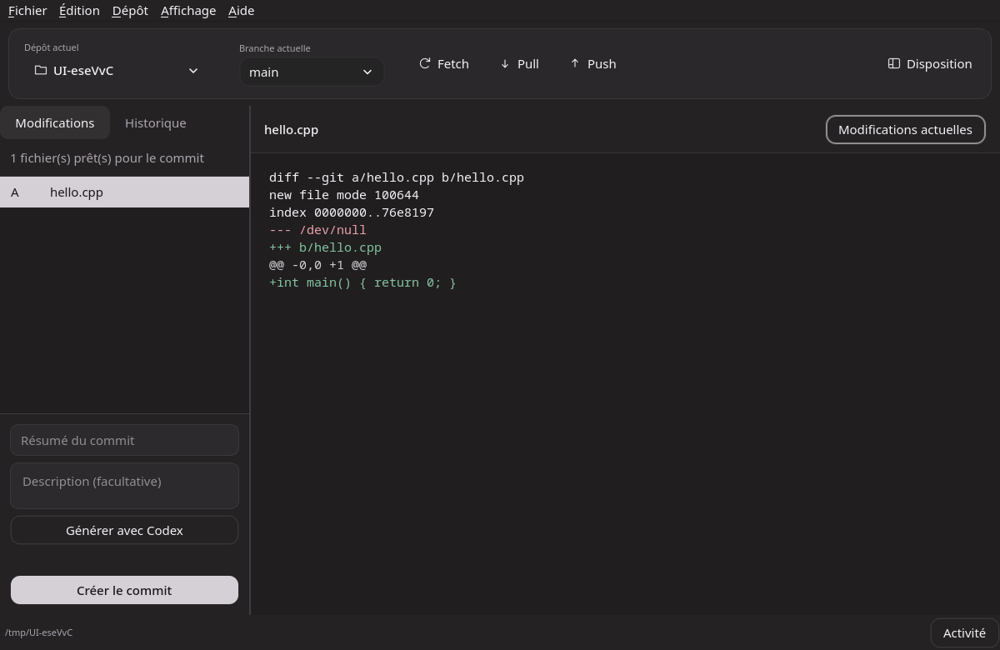

# GitHub Enhanced

Client Git desktop indépendant en **C++20 / Qt 6**, avec interface française. Version **0.2.6**. **Linux est fonctionnel ; Windows et macOS sont en bêta test.** Non affilié à GitHub.



## Déjà implémenté

- Ouverture, création et clonage de dépôts ; dépôts récents.
- Préparation automatique des fichiers modifiés, commits et historique avec contenu des fichiers et liste latérale à droite.
- État distant distinct : commits à envoyer/recevoir, divergence, branche suivie, dernière vérification et erreurs réseau visibles.
- Git LFS automatique pour les fichiers modifiés à partir de 50 Mio ; contrôle avant envoi et conversion proposée pour les gros fichiers déjà commités, avec sauvegarde locale. Installation automatique du composant officiel.
- Fenêtre d’activité avec progression et erreurs expliquées en français ; mode avancé mémorisé pour consulter les détails techniques ([guide](docs/ERRORS.md)). Suppression des raccourcis récents par une croix.
- Bouton Fetch/Push/Pull adaptatif avec fetch initial ; fusion de branches, résolution et annulation des conflits ; publication, configuration d’origin et stash.
- Mise à jour : vérification des releases GitHub au lancement, téléchargement vérifié SHA-256 et installation guidée ([détails](docs/UPDATES.md)).
- Icône de l’application et des paquets dérivée de `favicon.svg`.
- Interface inspirée du verre : palette charbon, cartes arrondies, chevrons fins et animations courtes.
- Bouton **Paramètres** et page **Mises à jour** : recherche manuelle et vérification automatique au lancement.
- Réglages à navigation latérale, éditeur de couleurs avec aperçu et sélecteur HSV/HEX, options de réduction des effets.
- Éditeur de disposition manipulable : glisser-déposer des panneaux, séparateurs et curseurs de dimensions en direct, annuler/rétablir, onglets et fenêtres détachées ; profils importables/exportables.
- Panneaux personnalisés de notes, tâches et état du dépôt ; création, suppression, persistance, import/export et annulation dans l’éditeur.
- Barre d’outils configurable : choix des commandes, ordre, visibilité, position et présentation.
- Sept palettes intégrées et presets de départ, éditeur de couleurs, import/export JSON et taille de texte.
- Chargement de catalogues de thèmes communautaires via HTTPS.
- Connexion OAuth GitHub et ChatGPT/Codex avec les outils officiels ; installation guidée des composants.
- Création/publication de dépôt sur le compte personnel ou une organisation accessible, avec compte connecté affiché, restrictions de visibilité et espaces remplacés par des tirets.
- Releases par dépôt : brouillons, préversions, notes, publication, fichiers joints et suppression.
- Liste et clonage des dépôts du compte, création/publication de dépôts GitHub, identité Git locale et éditeur `.gitignore`.
- Proposition de message de commit par Codex à partir des modifications préparées automatiquement, avec annulation et validation manuelle.
- Synchronisation manuelle du thème/disposition par Gist avec GitHub CLI.
- Commandes Git asynchrones, aucun blocage de l’interface durant les processus réseau.

La parité complète avec GitHub Desktop, la marketplace publique et la personnalisation intégrale restent à développer. Détails : [architecture et feuille de route](docs/ARCHITECTURE.md).

## Compiler et lancer

Prérequis : CMake ≥ 3.24, compilateur C++20, Ninja, Qt ≥ 6.4 (Widgets et Network), Git ≥ 2.28. GitHub CLI et Codex sont facultatifs et installables depuis les dialogues de connexion. Les réglages du dépôt permettent de définir l’identité Git locale.

```bash
# Arch Linux
sudo pacman -S --needed base-devel cmake ninja qt6-base git

# Debian 12+, Ubuntu 24.04+
sudo apt install build-essential cmake ninja-build qt6-base-dev git libgl1-mesa-dev

# Fedora
sudo dnf install gcc-c++ cmake ninja-build qt6-qtbase-devel git
```

Puis, dans le dossier du projet :

```bash
cmake --preset release
cmake --build --preset release --parallel 4
ctest --preset release
./build/release/github-enhanced
# ou : ./build/release/github-enhanced /chemin/vers/un/depot
```

Sur macOS : installez Xcode Command Line Tools, CMake, Ninja et Qt 6 ; avec Homebrew, `brew install cmake ninja qt git`, puis configurez avec `cmake --preset release -DCMAKE_PREFIX_PATH="$(brew --prefix qt)"`. Lancez `open build/release/github-enhanced.app`.

Sur Windows : Qt 6 pour MSVC 2022, Visual Studio 2022 avec le module C++, CMake, Ninja et Git for Windows. Dans un terminal développeur MSVC où Qt est accessible via `CMAKE_PREFIX_PATH`, utilisez les mêmes commandes CMake, puis lancez `build\release\github-enhanced.exe`.

## Installation et paquets

Le workflow [build.yml](.github/workflows/build.yml) prépare les builds et artefacts des trois systèmes à chaque push/PR et manuellement. Il doit être exécuté dans un dépôt GitHub pour produire les installateurs. Les builds Windows/macOS ne sont pas validés par la seule compilation Linux.

| Système | Formats configurés | Remarques |
|---|---|---|
| Windows x86_64 | installateur `.exe` (NSIS), `.msi` (WiX 4) | Qt déployé avec l’application ; Git à installer séparément |
| macOS Intel + Apple Silicon | `.app` universelle dans `.dmg` | Qt embarqué ; Git requis ; signature/notarisation à configurer |
| Debian / Ubuntu x86_64 | `.deb` | Qt et Git fournis par la distribution ; construit sur Ubuntu 24.04 en CI |
| Fedora / distributions RPM x86_64 | `.rpm` | dépendances natives ; à reconstruire/tester sur la distribution cible |
| Linux x86_64 | `.AppImage` | Qt embarqué, Git externe ; dépend encore de glibc et du système graphique hôte |
| Arch / dérivées | `.pkg.tar.zst` avec `makepkg` | recette locale x86_64/aarch64 ; pas encore publiée sur AUR |
| Autres Linux | sources, archive `.tar.gz` | compiler avec Qt ≥ 6.4 ; aucune garantie universelle |

Tous les installateurs sont non signés à ce stade. Les paquets CPack déploient Qt sous Windows/macOS. Les obligations de redistribution Qt et des autres dépendances doivent être respectées ; le code du projet est sous MIT, Qt conserve sa propre licence.

Pour générer localement les paquets compatibles avec l’OS courant :

```bash
# Linux : outils dpkg-dev / rpm requis selon les formats
cpack --config build/release/CPackConfig.cmake -G 'DEB;RPM;TGZ' -B dist
# AppImage x86_64 (télécharge linuxdeploy et son plugin Qt)
bash packaging/linux/appimage.sh
# Archive source pour Arch ou compilation locale
cpack --config build/release/CPackSourceConfig.cmake -B dist
cp dist/github-enhanced-0.2.6.tar.gz packaging/arch/
cd packaging/arch
makepkg -si
```

Pour Windows : la génération MSI nécessite CMake ≥ 3.30. Installez NSIS, .NET et WiX 4 (`dotnet tool install --global wix --version 4.0.6`, puis `wix extension add --global WixToolset.UI.wixext/4.0.6`) ; utilisez `cpack --config build/release/CPackConfig.cmake -G 'NSIS;WIX' -B dist`. Pour macOS : `cpack --config build/release/CPackConfig.cmake -G DragNDrop -B dist`.

L’AppImage ne crée aucun raccourci ni icône dans le profil utilisateur au lancement. Son intégration au menu des applications est gérée par l’outil de votre choix, par exemple Shelly.

Les formats ne garantissent pas une compatibilité avec **toutes** les versions de tous les OS. Le build AppImage de la CI prend Ubuntu 24.04 comme base ; pour les systèmes plus anciens, reconstruisez sur une base adaptée. ARM Linux nécessite une compilation native ; Windows ARM et Flatpak ne sont pas encore configurés.

Les fichiers déjà générés dans `dist/` sont issus du poste Linux local (glibc 2.44), et ne représentent pas des builds de la CI. Voir [les vérifications effectuées](docs/VALIDATION.md).

## Dépôts GitHub et releases

Dans **Mes dépôts GitHub… → Nouveau dépôt…**, le formulaire apparaît dans la fenêtre. Il vérifie le compte, valide le nom et conserve vos champs si GitHub refuse la création. Le README est proposé pour obtenir un dépôt immédiatement clonable.

**Dépôt → Releases du dépôt…** gère les releases du distant GitHub du dépôt ouvert ; le sélecteur permet de choisir un autre distant reconnu. Le bouton **Releases…** de Mes dépôts fonctionne aussi sans clone local. Vous pouvez créer/modifier une version, publier un brouillon, ajouter des fichiers comme une AppImage ou un installateur, télécharger les fichiers via le navigateur et supprimer une release ou une pièce jointe. Voir [le guide des releases](docs/RELEASES.md).

## Comprendre l’état du dépôt

**Aucune modification locale non commitée** signifie que les fichiers suivis correspondent au dernier commit local. Des commits peuvent encore être à envoyer sur GitHub. Le bandeau indique la branche, le suivi distant, les écarts et l’heure de vérification. **Envoyer**, **Récupérer** ou **Publier la branche** effectue l’action à votre demande. Les fichiers exclus par `.gitignore` restent locaux. Voir [la synchronisation et les commits](docs/WORKFLOW.md).

## Personnaliser

Cliquez sur **Disposition** dans la barre d’outils, ou **Affichage → Personnaliser l’interface…** (`Ctrl+Alt+L`, Command sur Mac). L’éditeur applique les changements en direct ; **Enregistrer** les conserve et **Annuler** restaure la disposition précédente. Voir [le guide des dispositions](docs/LAYOUTS.md).

**Fichier → Préférences** permet de changer de thème, charger des collections et synchroniser les préférences. Le thème Verre sombre est activé par défaut. Les effets peuvent être réduits dans Accessibilité. Un pont AppKit pour les fonds de dialogue est ajouté sur Mac, mais son intégration reste à valider sur cette plateforme. Voir [le format des thèmes et la synchronisation](docs/THEMES.md) et [le rendu verre et ses limites par plateforme](docs/GLASS.md).

## Comptes et messages de commit

Dans **Préférences → Compte GitHub / Compte Codex**, connectez les comptes dans le navigateur. **Mes dépôts GitHub…** permet de choisir un dépôt à cloner. **Dépôt → Réglages du dépôt…** configure origin, l’identité locale et `.gitignore`. Dans le panneau Commit, **Générer avec Codex** propose un message modifiable pour les fichiers modifiés. Voir [le fonctionnement des comptes et des autorisations](docs/ACCOUNTS.md).

## Validation

`ctest` utilise de vrais dépôts temporaires : chemins Unicode, espaces, tabulations, saut de ligne, noms commençant par un tiret, renommage, index vide avant premier commit, diff indexé, branches, HEAD détachée, remote local, push/fetch/pull/clone, file de processus et validation des thèmes. Une seconde suite pilote la vraie interface pour préparer automatiquement les fichiers, créer un commit, enregistrer un thème, déplacer le diff, redimensionner un panneau, détacher/regrouper l’historique, réordonner/masquer des commandes, sauver/charger un profil et vérifier l’annulation ainsi que la persistance après redémarrage. Elle vérifie aussi les menus déroulants, les pages de réglages, la saisie HEX, le choix de couleur, les interrupteurs et l’annulation des options visuelles. Sous Windows, les caractères interdits dans les noms de fichiers sont remplacés par une variante valide.

Un test de démarrage est disponible avec `QT_QPA_PLATFORM=offscreen ./build/release/github-enhanced --smoke-test`. Une capture peut être obtenue avec `--screenshot /tmp/github-enhanced.png`. Une troisième suite vérifie les intégrations OAuth et Codex avec des services simulés, les erreurs, annulations, dépôts paginés et la protection des brouillons. Les accès authentifiés réels et les installateurs doivent être vérifiés dans leur environnement réel.

Voir [le fonctionnement des commits, de LFS et des opérations](docs/WORKFLOW.md).
