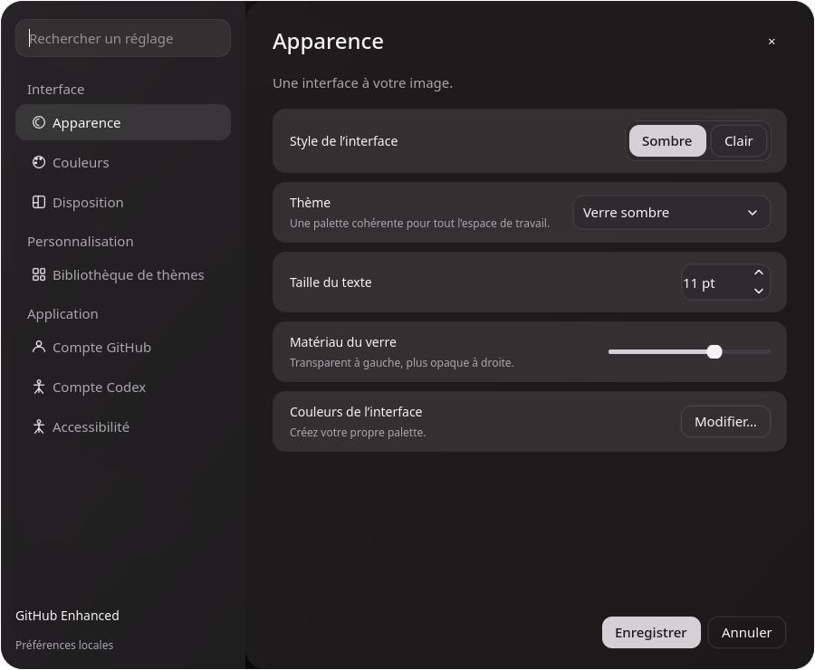

# Apparence et matériaux

L’interface utilise désormais une palette charbon légèrement chaude, des cartes arrondies, des boutons neutres, des chevrons fins et une navigation latérale pour les réglages. La capture fournie de Liner sert de référence visuelle ; aucun logo ni asset de cette application n’est intégré.

## Réglages

**Fichier → Préférences** ouvre les sections Apparence, Couleurs, Disposition, Bibliothèque de thèmes, Compte GitHub et Accessibilité. La recherche filtre les sections. Les boutons Enregistrer et Annuler conservent une validation explicite des changements.

L’onglet Couleurs permet de nommer une palette, modifier ses huit couleurs et voir un aperçu immédiat. Le sélecteur possède un plan saturation/luminosité, une teinte, des couleurs prédéfinies et une saisie HEX validée. Le plan est utilisable au clavier avec les flèches, et Maj augmente le pas. Une modification crée une variante locale, sans écraser un thème intégré.

Les réglages de réduction des animations, de transparence et d’opacité sont persistés avec le profil et inclus dans la synchronisation GitHub. Annuler rétablit aussi les réglages visuels précédents.

## Animations et flou

- Survol des boutons : environ 180 ms ; pression : 90 ms, relâchement : 160 ms.
- Changement de page : fondu de 160 ms, sans déplacer la mise en page.
- Interrupteurs : déplacement du curseur en 180 ms.
- Défilement : capsules peintes avec anticrénelage, élargissement sur 160 ms au survol, apparition en 110 ms et retour à une opacité discrète en 320 ms après une pause. Les vues inchangées conservent leur position au rafraîchissement.
- Ouverture des réglages : le fond de la fenêtre de l’application est flouté une seule fois et son voile apparaît en 180 ms.

Le flou portable est calculé depuis une capture en mémoire de la **propre fenêtre de l’application**. Il ne capture pas les autres applications et ne recalcule pas un flou plein écran à chaque image. L’éditeur de disposition reste non modal et conserve l’accès direct aux panneaux de la fenêtre principale.

## Liquid Glass natif et rendu portable

Sur Linux et Windows, les surfaces sont un rendu inspiré du verre, peint par Qt avec un fond de dialogue flouté et mis en cache. Ce rendu ne reproduit pas le matériau système, la réfraction ni la composition de Liquid Glass d’Apple.

Sur Mac, `nativeglass_mac.mm` ajoute un fond AppKit aux dialogues : `NSGlassEffectView` sur macOS 26 ou ultérieur, sinon `NSVisualEffectView`. Le pont utilise des classes et propriétés publiques, sans sélecteurs privés, et prend en compte Réduire les animations et Réduire la transparence du système. Les contrôles du client et la barre d’outils principale restent dessinés par Qt ; ils ne sont pas des contrôles SwiftUI/AppKit Liquid Glass natifs.

Le code AppKit et son intégration avec les vues Qt doivent encore être compilés et contrôlés sur un vrai Mac. L’apparence, l’accessibilité et les performances doivent y être validées avant de revendiquer une conformité Apple HIG ou une expérience identique aux applications Apple.

Références Apple : [Adopting Liquid Glass](https://developer.apple.com/documentation/technologyoverviews/adopting-liquid-glass), [NSGlassEffectView](https://developer.apple.com/documentation/appkit/nsglasseffectview), [NSVisualEffectView](https://developer.apple.com/documentation/appkit/nsvisualeffectview).
