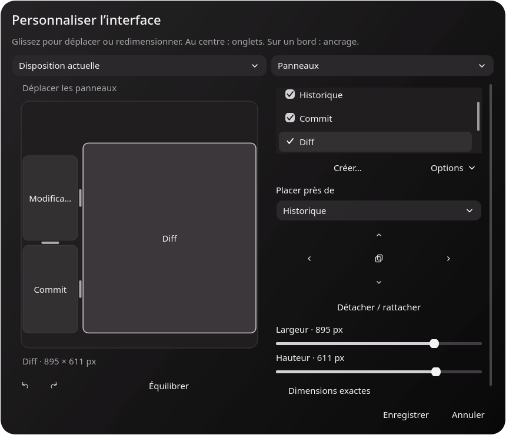

# Personnaliser la disposition

Ouvrez **Disposition** dans la barre d’outils ou **Affichage → Personnaliser l’interface…**. L’éditeur reste ouvert pendant que vous manipulez la fenêtre principale. Son aperçu représente les positions réelles des panneaux et permet de les manipuler directement.

Le sélecteur de section donne accès aux **Panneaux**, à la **Barre d’outils** et aux **Profils**. Les options secondaires sont repliées ; le contenu défile si la fenêtre ou la taille du texte ne permet pas de tout afficher. Les lignes des listes suivent la taille de police.

## Panneaux

Les six vues sont indépendantes : **Modifications**, **Historique**, **Commit**, **Diff**, **Dépôts récents** et **Journal**.

- Cochez une vue pour l’afficher, décochez-la pour la masquer.
- Dans **Placer près de**, choisissez une vue de référence puis une direction ou le regroupement en onglets. **Détacher / rattacher** transforme le panneau en fenêtre indépendante ou le réintègre.
- Déplacez les séparateurs dans l’aperçu pour redimensionner deux panneaux voisins. Les poignées ont une zone de saisie élargie.
- Sélectionnez un panneau puis ajustez les curseurs **Largeur** et **Hauteur** : la fenêtre se met à jour immédiatement. Les dimensions restent contraintes par l’espace disponible et les tailles minimales des vues.
- Glissez un panneau sur un autre : les zones indiquent gauche, droite, haut, bas ou regroupement en onglets. Glissez-le sur le bord extérieur de l’aperçu pour l’ancrer sur toute la hauteur ou largeur de ce côté. Une vue masquée peut être glissée depuis la liste.
- **Annuler / Rétablir** parcourt les modifications ; **Équilibrer** répartit l’espace. **Dimensions exactes** conserve la saisie numérique et les placements précis.
- Au clavier dans l’aperçu : les flèches ajustent les dimensions, Maj accélère ; Échap annule le geste en cours.
- Pour positionner deux vues, choisissez un panneau de référence puis gauche, droite, au-dessus, en dessous ou en onglet.
- Vous pouvez également déplacer les en-têtes des panneaux directement dans la fenêtre principale, les redimensionner par les séparateurs et faire glisser les onglets.

Le sélecteur de disposition propose trois points de départ. **Desktop** remet les fichiers et l’historique dans la colonne de gauche avec le commit dessous et le diff à droite. **Revue** affiche l’historique séparément et le journal. **Focus** garde uniquement le diff.

## Barre d’outils

Choisissez **Barre d’outils** dans le sélecteur de section. Filtrez les commandes par leur nom, puis cochez celles à afficher. Effacez le filtre pour réorganiser toute la liste par glissement, ou utilisez **Monter / Descendre**. Cochez celles à afficher, y compris les commandes supplémentaires (nouvelle branche, indexation, commit, stash, préférences…). Un espace flexible peut être déplacé pour séparer les groupes.

La barre d’outils peut être placée sur les quatre côtés de la fenêtre, masquée, et afficher des icônes, du texte ou les deux. Les sélecteurs de dépôt et de branche restent des contrôles complets. Les commandes restent accessibles dans les menus lorsque leurs boutons sont masqués. La barre d’état peut également être masquée.

## Profils et sauvegarde

**Profils → Enregistrer sous…** crée une disposition nommée, accessible aussi dans le menu **Affichage → Dispositions enregistrées**. Vous pouvez la charger, la supprimer, l’importer ou l’exporter en JSON. Le profil comprend les onglets, les panneaux flottants et la configuration des commandes, sans chemin de dépôt ni identifiant GitHub.

**Enregistrer** conserve la disposition courante et verrouille les panneaux. **Annuler** restaure la disposition d’avant l’ouverture de l’éditeur, y compris l’ordre des commandes. Les profils explicitement enregistrés ou supprimés dans la bibliothèque restent enregistrés ou supprimés. La disposition courante est restaurée au prochain lancement et incluse dans la synchronisation des préférences via GitHub CLI.

Le menu **Affichage → Verrouiller la disposition** permet aussi de manipuler les panneaux sans ouvrir l’éditeur. **Rétablir la disposition initiale** reste accessible si vous masquez la barre d’outils ou toutes les vues.

Les dispositions de l’ancienne interface peuvent nécessiter un nouvel enregistrement. Cette personnalisation porte sur les vues et les commandes ; l’ordre des champs à l’intérieur du formulaire de commit et les raccourcis individuels ne sont pas encore éditables.

Dans **Préférences → Couleurs**, l’aperçu en direct applique les modifications à la fenêtre principale. **Annuler** restaure l’apparence initiale ; l’interrupteur d’aperçu permet de suspendre ces changements temporaires.

## Panneaux personnalisés

Dans **Personnaliser l’interface → Panneaux → Créer…**, choisissez un nom et un type : notes libres, liste de tâches ou état du dépôt. Les notes et tâches sont modifiables directement dans le panneau ; l’état du dépôt suit la branche sélectionnée. Vous pouvez créer jusqu’à 16 panneaux, les déplacer, redimensionner, détacher, empiler en onglets, masquer, renommer ou retirer depuis l’éditeur.

Les panneaux, leur contenu et leur disposition sont enregistrés dans le profil. Annuler/rétablir dans l’éditeur s’applique aussi à leur création ou suppression. **Annuler** rétablit la disposition d’avant l’ouverture. Les profils peuvent être exportés/importés ; la validation refuse les types inconnus, les identifiants dupliqués et les contenus excessifs. Les notes sont limitées à 64 K caractères, et les listes à 200 tâches.

La synchronisation volontaire des préférences dans un Gist inclut le contenu des panneaux personnalisés. Ce contenu n’est pas écrit dans les fichiers du dépôt.

Si la barre d’outils est masquée, **Afficher la barre d’outils** apparaît dans la barre de menus (ou la barre d’état avec les menus système). Le menu **Affichage → Barre d’outils** et le raccourci **Ctrl+Maj+T** permettent aussi de la basculer.
