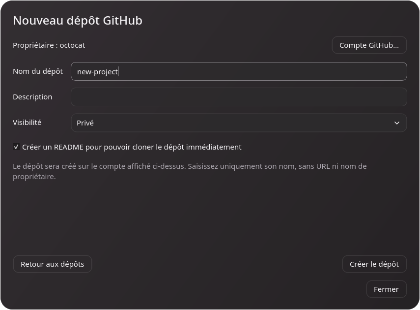
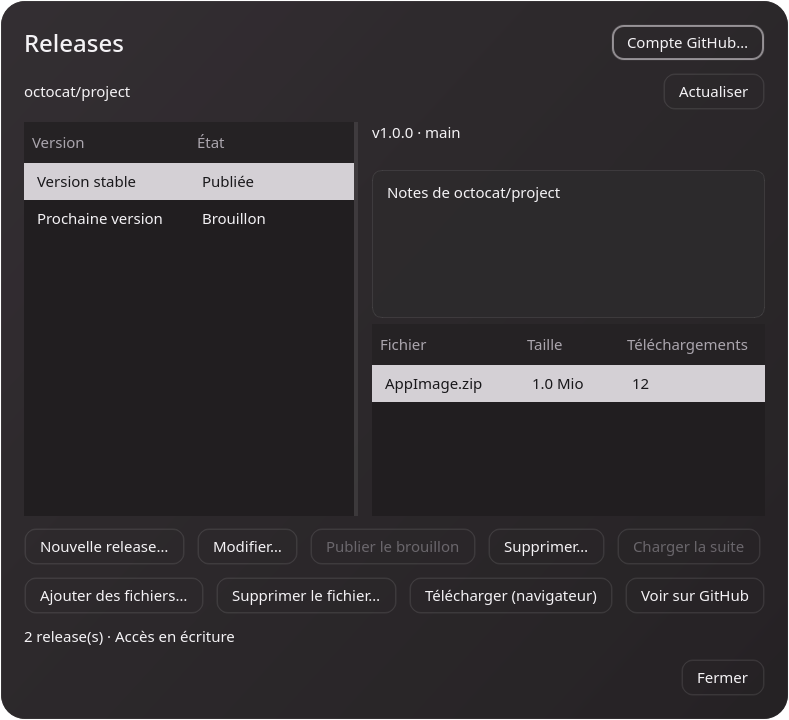

# Dépôts GitHub et releases

## Créer un dépôt

**Mes dépôts GitHub… → Nouveau dépôt…** affiche le formulaire dans la même fenêtre. Le compte propriétaire est vérifié à chaque ouverture. Saisissez un nom, une description et la visibilité ; les dépôts sont privés par défaut. L’option README crée un premier commit distant et facilite le clonage immédiat.

Le bouton Créer est désactivé tant que le compte ou le nom ne sont pas valides. Pendant la requête, un indicateur montre la création en cours. Une erreur GitHub, notamment un nom déjà utilisé, reste affichée avec les champs conservés pour réessayer. Après succès, le dépôt est sélectionné dans la liste, même si un filtre masquait les autres résultats.

## Choisir le dépôt des releases

Ouvrez **Dépôt → Releases du dépôt…**. L’application lit les distants du dépôt local et reconnaît les URL GitHub HTTPS, SSH et `git@github.com:propriétaire/dépôt.git`. `origin` est proposé en premier. Le nom complet propriétaire/dépôt reste visible ; le sélecteur de distant permet de changer explicitement de cible. Les réponses devenues obsolètes après un changement de cible sont ignorées.

Dans **Mes dépôts GitHub…**, sélectionnez un dépôt puis **Releases…** pour gérer ses versions sans clone local. Les dépôts sans droit d’écriture restent consultables ; les commandes de modification sont désactivées. GitHub Enterprise et les alias SSH personnalisés ne sont pas résolus automatiquement.

## Créer et modifier une version

**Nouvelle release…** demande un tag, un titre, les notes Markdown et la branche ou le SHA distant ciblé. GitHub crée le tag s’il manque ; la cible doit exister sur le serveur. Les brouillons sont activés par défaut ; Préversion est une option indépendante. Une release publiée conserve donc son caractère de préversion si cette option est cochée.

Des fichiers peuvent être sélectionnés avant la création. Une nouvelle release est d’abord créée en brouillon, puis les pièces jointes sont envoyées. Si vous avez décoché Brouillon, elle est publiée après la réussite des transferts. Si un transfert échoue, le brouillon et les fichiers déjà envoyés restent sur GitHub ; réessayer reprend les fichiers restants sans recréer une release.

**Modifier…** change le titre, les notes et les états brouillon/préversion. Le tag reste en lecture seule. **Publier le brouillon** rend la release visible sans changer le tag ni commiter les fichiers locaux. Les releases immuables sont traitées en lecture seule par ce client.

## Fichiers et suppressions

**Ajouter des fichiers…** envoie les fichiers vers la release sélectionnée via GitHub CLI, avec un délai de transfert adapté aux gros fichiers. Les données du fichier sont lues par le composant officiel ; elles ne sont pas chargées dans la fenêtre Qt. Une fenêtre d’activité et un état dans le formulaire indiquent l’opération. Les chemins contenant espaces ou `#` sont transmis comme fichiers, sans commande shell.

Une AppImage, un EXE, un MSI ou un DMG peut ainsi être distribué comme pièce jointe de release sans être ajouté à un commit Git. Les noms déjà existants sont refusés par GitHub : aucune pièce jointe n’est écrasée automatiquement. **Télécharger** ouvre son URL GitHub dans le navigateur ; l’accès à une pièce jointe privée dépend aussi de la session du navigateur.

Les suppressions demandent une confirmation avec le dépôt et le nom ciblés. Supprimer une release supprime ses pièces jointes, mais conserve son tag Git. Les opérations en cours empêchent la fermeture du dialogue pour éviter un résultat distant inconnu.

Sources : [GitHub Releases API](https://docs.github.com/en/rest/releases/releases), [Release assets API](https://docs.github.com/en/rest/releases/assets), [GitHub CLI API](https://cli.github.com/manual/gh_api).
