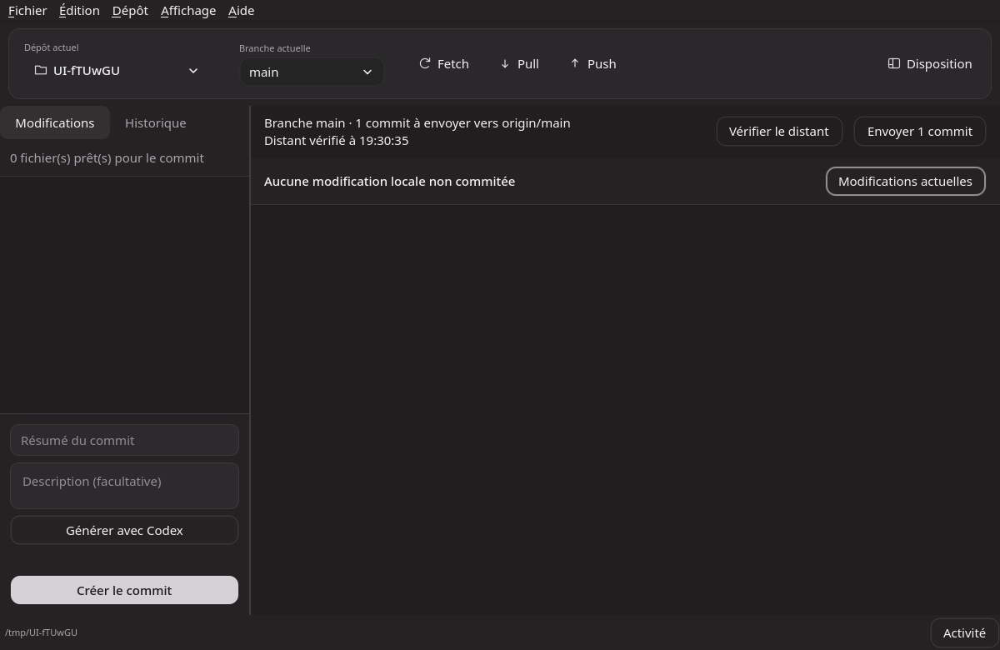
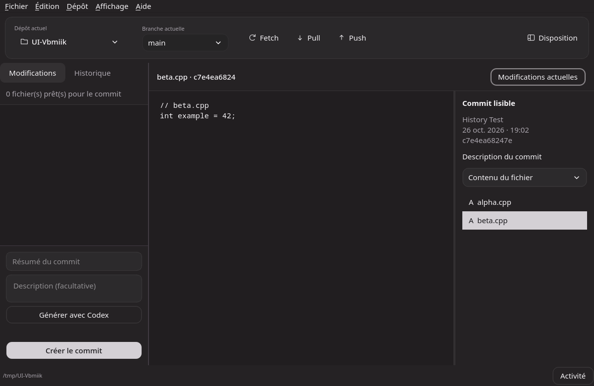
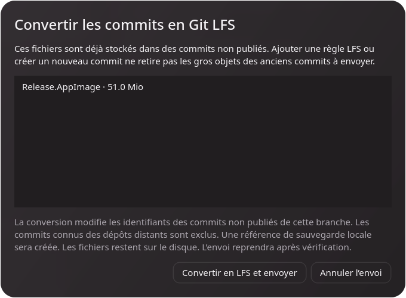
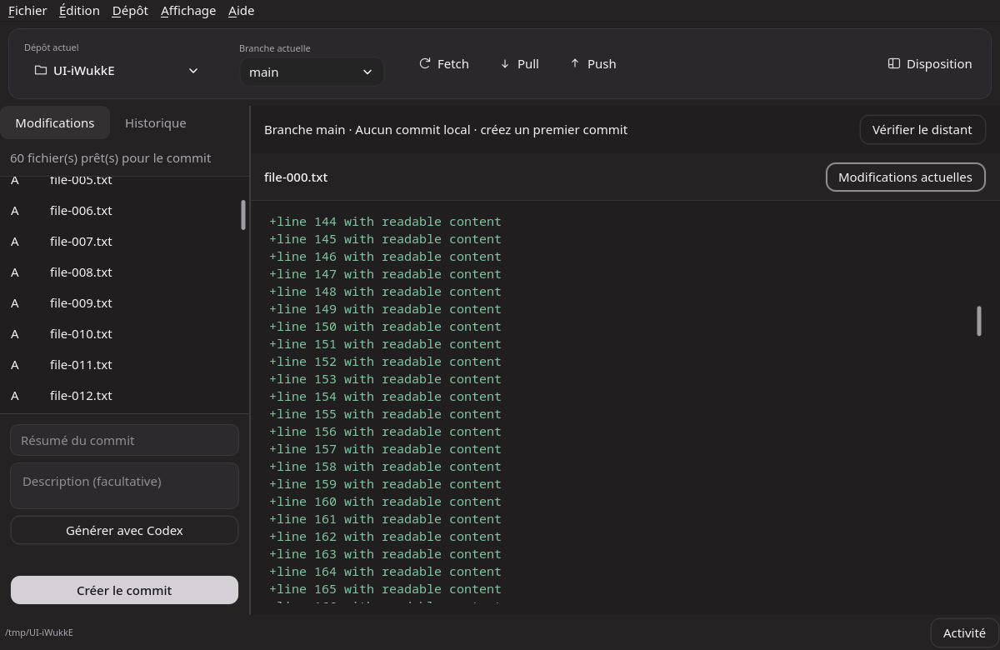
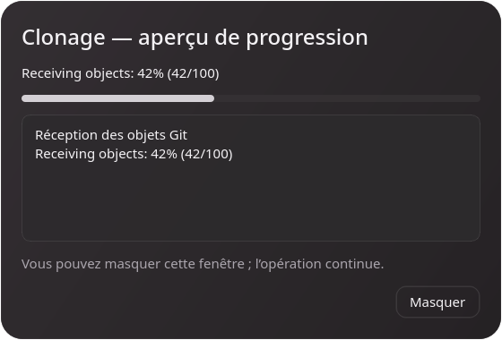

# Commits, historique et opérations

## État local et dépôt distant

L’état des fichiers et l’état des commits sont présentés séparément. Une arborescence locale propre ne signifie pas que GitHub contient le dernier commit. Le bandeau affiche la branche locale et la branche suivie, les commits à envoyer/recevoir, les divergences et l’heure de la dernière vérification distante.

Les références sont récupérées par `git fetch --prune` à l’ouverture du dépôt, à la demande et toutes les 60 secondes lorsque le dépôt est disponible. Cela ne modifie pas les fichiers de travail et n’envoie aucun commit. Une vérification distante est bornée à 30 secondes. Les échecs réseau/authentification restent visibles et empêchent d’annoncer une synchronisation vérifiée ; une comparaison avec des références uniquement en cache est indiquée comme telle.

**Envoyer N commits** envoie la révision affichée à la branche distante suivie. L’application revérifie la branche et la révision avant l’action. **Récupérer N commits** effectue un pull rapide uniquement, qui refuse les divergences. **Publier la branche** configure le suivi distant lorsqu’il manque. En cas de divergence, **Voir les écarts** montre les commits des deux côtés ; une fusion ou un rebase reste à préparer dans un outil Git. Aucun envoi forcé, remplacement de fichiers ou résolution automatique de conflit n’est ajouté.

Les différences sont calculées sur la branche affichée, qui peut différer de la branche sélectionnée sur le site GitHub. Les fichiers exclus par `.gitignore`, notamment les sorties de compilation, restent présents sur disque sans être publiés. Lorsque des fichiers locaux restent à commiter, le bandeau l’indique même si tous les commits existants sont déjà envoyés.

## Modifications automatiquement préparées

À l’ouverture et à l’actualisation d’un dépôt, tous les fichiers modifiés non ignorés sont préparés pour le prochain commit. Les fichiers nouveaux, modifiés et supprimés sont inclus. Les boutons Indexer/Désindexer ont été retirés. La préparation est vérifiée de nouveau avant un commit ou une génération Codex.

La fenêtre active vérifie les modifications toutes les 2,5 secondes lorsqu’aucune opération n’est en cours. Un conflit Git suspend la préparation automatique ; l’application ne considère pas les marqueurs de conflit comme une résolution. Les règles `.gitignore` sont respectées. L’application ne crée ni commit ni push à votre place.

## Gros fichiers et Git LFS

Un fichier modifié de **50 Mio ou plus** est suivi par Git LFS avec une règle de nom de fichier littéral dans `.gitattributes`, qui est aussi préparé pour le commit. Git LFS est configuré localement dans le dépôt. Son hook d’envoi assure le transfert des objets lors du push. La préparation automatique ne réécrit pas l’historique. Un contrôle distinct avant envoi propose la conversion des commits non publiés lorsque nécessaire.

Si Git LFS manque, le composant officiel correspondant à votre OS/architecture est téléchargé depuis les releases `git-lfs/git-lfs`, vérifié par SHA-256 et installé dans le profil utilisateur de l’application. L’avancement apparaît dans Activité. Une erreur d’installation, de hook existant incompatible ou de suivi LFS bloque la préparation et conserve les fichiers sur disque. Un `.gitattributes` symbolique est refusé pour empêcher une écriture hors du dépôt.

Les paquets Git LFS peuvent aussi être installés avec votre gestionnaire de paquets. L’hébergement distant doit prendre en charge LFS et les limites du compte s’appliquent aux transferts. Voir [Git LFS](https://git-lfs.com/) et [la commande track](https://github.com/git-lfs/git-lfs/blob/main/docs/man/git-lfs-track.adoc).

## Fichier volumineux déjà présent dans un commit

Avant chaque envoi, l’application récupère les références distantes et inspecte les objets des commits non publiés. Un fichier volumineux est détecté même s’il a été supprimé dans un commit local ultérieur. Cela évite de transférer un gros paquet pour découvrir ensuite un rejet `GH001`.

Si des objets Git classiques de 50 Mio ou plus sont présents, une fenêtre affiche leur nom et leur taille. **Convertir en LFS et envoyer** convertit les commits non publiés de la branche courante, après une nouvelle vérification du dépôt. Leurs identifiants changent. Les commits accessibles par les références distantes récupérées sont exclus de la conversion. Les modifications locales non commitées empêchent la conversion ; Annuler conserve les commits existants.

Une référence `refs/github-enhanced/lfs-backups/...` conserve le commit original. Un dossier `github-enhanced-lfs-*` dans le dossier Git conserve les références initiales et la correspondance entre anciens et nouveaux commits. Le convertisseur rétablit les références de sauvegarde et les autres références locales que Git LFS a remappées, avec vérification de leur valeur. Les fichiers LFS sont restaurés localement et vérifiés avant l’envoi ; l’application rescane ensuite les commits et envoie le nouvel identifiant, avec un push normal.

Créer simplement un nouveau commit contenant un pointeur LFS ne suffit pas si le gros objet figure encore dans un commit parent à envoyer. Cette conversion traite donc la partie non publiée de l’historique. Voir [Git LFS — migrate](https://github.com/git-lfs/git-lfs/blob/main/docs/man/git-lfs-migrate.adoc) et [les limites GitHub](https://docs.github.com/en/repositories/working-with-files/managing-large-files/about-large-files-on-github).

## Consulter un commit

Cliquez sur un commit dans Historique. Le bandeau de droite affiche son résumé, son auteur, sa date, sa description et les fichiers concernés. La sélection d’un fichier affiche son contenu à cette révision. Le sélecteur **Modifications du fichier** affiche uniquement son diff. Pour un fichier supprimé, le contenu de la révision précédente est présenté. Les fichiers binaires et pointeurs LFS sont identifiés ; les aperçus sont limités à 1 Mio.

**Modifications actuelles** ramène à la vue du prochain commit. La croix des dépôts récents retire uniquement le raccourci de l’accès rapide, dans la liste et dans le menu de dépôt. Elle conserve le dossier et le dépôt ouvert.

## Activité et défilement

Les opérations longues ouvrent une fenêtre après un court délai, pour éviter les clignotements lors des opérations immédiates. Elle affiche les étapes et les détails Git. Le pourcentage n’est affiché dans la barre que lorsqu’il est fourni par l’outil ; sinon la barre reste indéterminée. La fenêtre peut être masquée et rouverte avec **Activité** dans la barre d’état. Les erreurs restent affichées.

Les barres sont dessinées comme de vraies capsules avec extrémités arrondies, sans piste opaque ni flèches. Le curseur s’élargit progressivement au survol et son opacité évolue pendant/après le défilement. La zone interactive reste de 14 px, avec un curseur de 36 px minimum. Le glissement, les clics de page et le clavier restent utilisables.

Le défilement à molette est animé ; les gestes précis du pavé tactile conservent leur traitement habituel. Réduire les animations désactive l’adoucissement et les transitions des indicateurs. Les listes et textes identiques ne sont plus reconstruits à chaque actualisation ; leur position et leur sélection sont conservées. La direction de conception suit les [Apple HIG — Scroll views](https://developer.apple.com/design/human-interface-guidelines/scroll-views), sans revendiquer une conformité native macOS non testée.

## Synchronisation et fusion

Un bouton unique de la barre d’outils affiche Fetch, Push, Pull, Publier ou Fusionner selon l’état réellement constaté. Le dépôt est récupéré à l’ouverture et revérifié périodiquement. Le distant est celui de la branche suivie ; à défaut, origin ou le premier distant est utilisé. Une branche distante du même nom peut être comparée sans modifier silencieusement la configuration de suivi Git.

**Dépôt → Fusionner une branche…** intègre une branche locale ou distante dans la branche courante. Le dialogue affiche les commits propres à chaque côté, vérifie la branche, HEAD, l’état de fusion et les modifications locales avant l’opération. La cible est figée par son identifiant de commit. L’autostash est désactivé pour cette fusion : commitez ou mettez de côté les modifications locales avant de commencer.

En cas de conflit, sélectionnez un fichier puis choisissez la version locale, la version entrante ou ouvrez-le dans votre éditeur avant de cliquer sur **Marquer résolu**. **Terminer la fusion** crée le commit lorsque tous les conflits sont résolus. **Annuler la fusion** appelle `git merge --abort`. Fermer le dialogue en conservant des conflits laisse la fusion en cours ; rouvrez-le pour continuer. Aucun push n’est réalisé par la fusion et aucun push forcé n’est utilisé.

Cette logique s’appuie sur les mêmes primitives Git que [GitHub Desktop Linux](https://github.com/shiftkey/desktop/blob/linux/app/src/lib/git/merge.ts), avec une implémentation C++ indépendante.

## Actualisation et saisie

La surveillance locale vérifie silencieusement l’état Git et les références toutes les 2,5 secondes lorsque la fenêtre est active. Les vues sont actualisées uniquement si ces informations changent ; les contrôles de saisie restent actifs pendant les lectures Git. Le focus, la sélection du texte et les panneaux en onglets sont conservés. La surveillance attend la fermeture de l’éditeur de disposition.

Un commit utilise le résumé et la description validés au clic. Si vous modifiez ces champs pendant sa création, le nouveau brouillon est conservé après la réussite du commit.
